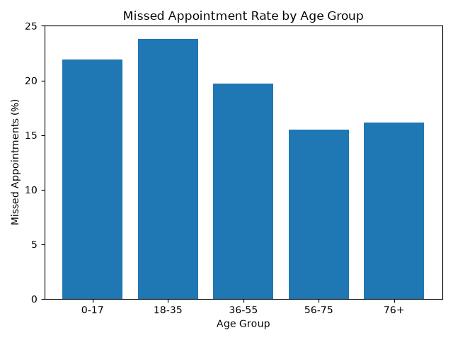
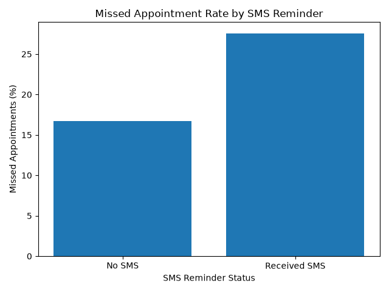
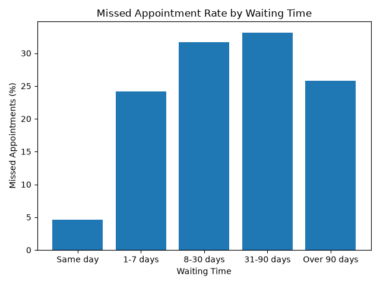

# Exploratory Data Analysis: Medical Appointment No-Shows

## Project Overview

This project explores a medical appointment dataset to understand patient attendance patterns and identify factors associated with missed appointments.

I used Python to inspect the data, investigate data quality issues, calculate attendance rates, and create charts to communicate the findings.

## Project Objectives

* Understand the structure of the dataset.
* Check for missing values and duplicate records.
* Investigate unusual patient ages and waiting times.
* Analyze appointment attendance patterns.
* Compare missed appointments across age groups and genders.
* Explore the relationship between SMS reminders and appointment attendance.
* Visualize findings using charts.

## Tools Used

* Python
* Pandas
* Matplotlib
* Visual Studio Code
* GitHub

## Dataset

The project uses the Medical Appointment No Shows dataset published by `joniarroba` on Kaggle.

The dataset contains 110,527 appointment records and 14 original columns.

The original dataset was retained without deleting or changing records during the data quality checks.

**Dataset source:** [Medical Appointment No Shows on Kaggle](https://www.kaggle.com/joniarroba/noshowappointments)

**Licence:** CC BY-NC-SA 4.0, as listed on the dataset page.

## Analysis Performed

1. Inspected the dataset structure and column names.
2. Checked for missing values and duplicate records.
3. Investigated unusual patient ages.
4. Calculated overall appointment attendance and missed appointment rates.
5. Compared attendance patterns by gender and age group.
6. Examined attendance among patients who did and did not receive SMS reminders.
7. Calculated waiting times between scheduling and appointment dates.
8. Investigated records with negative waiting times.
9. Compared missed appointment rates across waiting-time groups.
10. Created charts to present selected findings.

## Key Findings

* The dataset contains 110,527 appointment records.
* No missing values or duplicate rows were detected.
* One record had a negative patient age, and seven records had ages above 100.
* Approximately 20.19% of appointments were recorded as missed.
* Patients aged 18–35 had the highest missed appointment rate among the age groups analyzed, at 23.82%.
* The missed appointment rate was 27.57% among patients who received SMS reminders and 16.70% among those who did not.
* Same-day appointments had the lowest missed appointment rate, at 4.65%.
* Appointments with waiting times of 31–90 days had the highest missed appointment rate among the waiting-time groups, at 33.16%.
* Five records had negative waiting times and were flagged for investigation.

## Visualizations

The project generates three charts:

### 1. Missed Appointments by Age Group

File: `missed_appointments_by_age.png`

Compares missed appointment rates across patient age groups.

### 2. Missed Appointments by SMS Reminder

File: `missed_appointments_by_sms.png`

Compares missed appointment rates between patients who received SMS reminders and those who did not.

### 3. Missed Appointments by Waiting Time

File: `missed_appointments_by_waiting_time.png`

Compares missed appointment rates across different waiting-time groups.

## Data Quality and Limitations

Unusual values were investigated without deleting records from the original dataset.

Negative waiting times were excluded from the waiting-time group comparison but retained in the original data.

The results show associations in this dataset and do not establish that SMS reminders or waiting times cause patients to miss appointments.

The group with waiting times above 90 days contains relatively few records, so its results should be interpreted cautiously.

## How to Run the Project

1. Install Python.

2. Install the required libraries:

   `pip install pandas matplotlib`

3. Download the original dataset from Kaggle.

4. Place `KaggleV2-May-2016.csv` in the project folder.

5. Open a terminal in the project folder.

6. Run the analysis:

   `python analysis.py`

## Skills Demonstrated

* Data inspection and exploration
* Data quality checks
* Data grouping and aggregation
* Percentage calculations
* Exploratory data analysis
* Data visualization
* Communicating findings
* Basic Python programming

## Conclusion

This project provided practical experience using Python to explore a real-world healthcare dataset, investigate data quality issues, identify attendance patterns, and communicate findings through visualizations.
